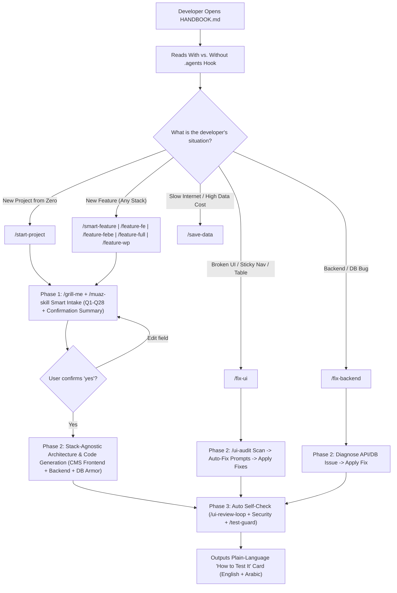

# 03 — App Flow & State Machine: Agent OS Beginner Handbook & 11 Situation Combo Skills

## 1. Route & Command Map

| Command / Entry Point | Target Scope | Trigger Type | Primary Output |
| :--- | :--- | :--- | :--- |
| `HANDBOOK.md` | Root Onboarding & Situation Guide | Developer reads & copies prompt | Instant selection of the right workflow |
| `/save-data` | Low-Bandwidth & Token Saver | Slash Command / Copy-Paste | Applies `data-saver` + `/caveman lite` + offline caches |
| `/start-project` | New Project from Zero (Any Stack) | Slash Command / Copy-Paste | `/grill-me` + `/muaz-skill` Intake → `/web-precode` → `/spec-kit` → Build |
| `/smart-feature` | Auto-Picked Skills from Description | Slash Command / Copy-Paste | Detects stack + routes skills → `/grill-me` Intake → Build → Self-Check |
| `/feature-fe` | Frontend / CMS UI Feature | Slash Command / Copy-Paste | `/grill-me` Intake → Sticky Nav/Sidebar/Tables/Forms + RTL → Self-Check |
| `/feature-febe` | Frontend + Backend Feature | Slash Command / Copy-Paste | `/feature-fe` + API, RBAC, Pagination, Validation, File Uploads |
| `/feature-full` | Frontend + Backend + Database | Slash Command / Copy-Paste | `/feature-febe` + Schema, Foreign Keys, Indexes, Soft Deletes |
| `/feature-wp` | WordPress / WooCommerce Feature | Slash Command / Copy-Paste | `/grill-me` Intake → `/wp-guard` + `/woo-guard` + `/muaz-skill` |
| `/fix-ui` | UI Violations & Broken Layouts | Slash Command / Copy-Paste | `/ui-audit` → Auto Fix Prompts → `/ui-review-loop` + CMS Shell Fixes |
| `/fix-backend` | Backend, Auth, API, or DB Bug | Slash Command / Copy-Paste | Root-cause analysis → Fix → Regression test via `/test-guard` |
| `/check-all` | Pre-PR Security & Bloat Audit | Slash Command / Copy-Paste | Security guards + `/ponytail-review` + `/debate-review` |
| `/doc-project` | Project Documentation | Slash Command / Copy-Paste | Generates `README.md`, `docs/ARCHITECTURE.md`, `docs/API.md` |

---

## 2. Mermaid Flowchart (The 1-2-3 Traffic Light Workflow)

---

## 3. The 5-State UI Matrix (Mandatory for Every Generated Frontend / CMS View)

Every UI page, CMS data table, and form generated via `/feature-fe`, `/feature-febe`, `/feature-full`, `/smart-feature`, or `/fix-ui` MUST implement all 5 states:

| UI State | Visual & Behavioral Requirement |
| :--- | :--- |
| **Idle** | Clean resting layout with sticky top navbar (`sticky top-0 z-40`), independent-scroll sticky sidebar (`h-dvh sticky top-0 overflow-y-auto`), and `flex-1 min-w-0` main content container. |
| **Loading / Pending** | Skeleton shimmer rows for CMS data tables, disabled submit button with spinner during form submission, and non-blocking filter/pagination loading indicators. |
| **Success** | Clear feedback toast/banner in the active locale (LTR/RTL), optimistic or revalidated table state, and clean redirect or modal dismissal. |
| **Error / Rejection** | Field-by-field inline validation messages below form inputs (`422`), permission denied alert (`403`), and a user-friendly retry button on network/server failure (`500`). |
| **Empty** | Dedicated empty-state illustration/icon inside CMS tables or lists with a clear explanation and a primary Call-to-Action button (e.g., "+ Add First Record"). |

---

## 4. Session & Auth Sequence
- Before rendering protected CMS routes or executing backend mutations, the active combo command enforces server-side session verification and RBAC role checks (`Admin`, `Editor`, `Viewer`).
- Expired sessions redirect cleanly to the login route while preserving the intended return URL.
- Unauthorized role actions hide restricted UI controls on the frontend AND reject unauthorized calls with `403 Forbidden` on the backend.

---

## 5. Edge & Resilience Protocols
- **Wide Table Overflow Protection**: Main content column uses `flex-1 min-w-0` and tables use `overflow-x-auto` so 15-column CMS tables never push the sidebar or break mobile viewports.
- **Offline / Low-Bandwidth Resilience**: `/save-data` configures offline cache flags (`--prefer-offline`) so package installs and IDE operations survive unstable mobile connections.
