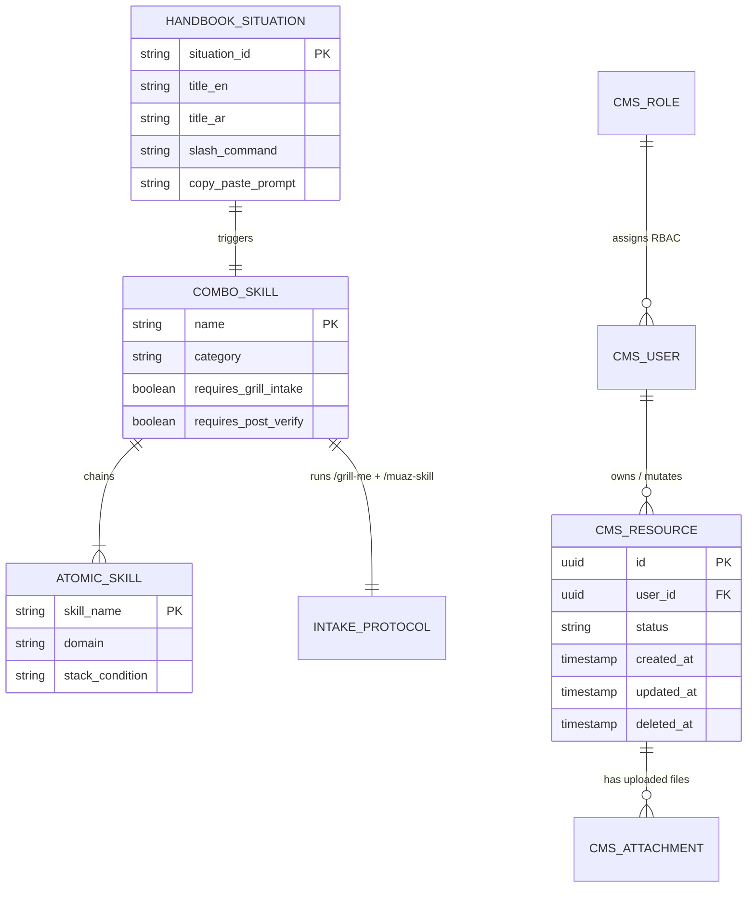

# 05 — Backend Schema & Data Model: Agent OS Skill Registry & CMS Database Standards

## 1. Storage Engine & Driver
- **Agent OS Registry Storage**: File-based JSON index (`SKILL_INDEX.json`) + Markdown skill definitions (`skills/<skill-name>/SKILL.md`) synchronized deterministically via Python (`scripts/agent_os.py`).
- **Target Project Database Engines (Enforced by `/feature-full`, `/start-project`, `/fix-backend`)**:
  - Relational SQL: **PostgreSQL**, **MySQL / MariaDB**, **SQLite** (via Prisma, Drizzle, Laravel Eloquent, TypeORM, SQLAlchemy, or Django ORM).
  - Document / Cloud: **MongoDB**, **Firebase Firestore**, **Supabase**, **Bigtable**.

---

## 2. Mermaid ERD (`erDiagram`) — Combo Skill Orchestration & CMS Reference Model



---

## 3. DDL / Table Definitions (Mandatory CMS Database Blueprint)
Whenever `/feature-full` or `/start-project` generates a relational database table for a CMS or web app, it enforces this canonical structure:

```sql
CREATE TABLE cms_records (
    id BIGINT UNSIGNED AUTO_INCREMENT PRIMARY KEY,
    organization_id BIGINT UNSIGNED NOT NULL,
    created_by_user_id BIGINT UNSIGNED NOT NULL,
    title VARCHAR(255) NOT NULL,
    slug VARCHAR(255) NOT NULL UNIQUE,
    status ENUM('draft', 'active', 'archived') NOT NULL DEFAULT 'draft',
    attachment_path VARCHAR(512) NULL,
    created_at TIMESTAMP NOT NULL DEFAULT CURRENT_TIMESTAMP,
    updated_at TIMESTAMP NOT NULL DEFAULT CURRENT_TIMESTAMP ON UPDATE CURRENT_TIMESTAMP,
    deleted_at TIMESTAMP NULL DEFAULT NULL,
    CONSTRAINT fk_cms_records_org FOREIGN KEY (organization_id) REFERENCES organizations(id) ON DELETE RESTRICT,
    CONSTRAINT fk_cms_records_user FOREIGN KEY (created_by_user_id) REFERENCES users(id) ON DELETE RESTRICT
);
```

---

## 4. Indexing Strategy
Every database schema generated or audited by `/feature-full` and `/fix-backend` must include:
1. **Foreign Key Indexes**: Explicit index on every `*_id` foreign key column (`organization_id`, `created_by_user_id`) to prevent full-table scans on joins.
2. **CMS Table Search & Filter Indexes**: Compound indexes on columns used by CMS table filters, sorting, and pagination (e.g., `INDEX idx_org_status_created (organization_id, status, created_at DESC)`).
3. **Soft Delete Filtering Index**: Include `deleted_at` in compound lookup indexes so active-record queries remain fast.

---

## 5. Data Integrity & Lifecycle Rules
1. **Explicit Cascade Policies**: Default to `ON DELETE RESTRICT` on critical parent entities (users, tenants, orders, invoices) to prevent accidental mass data loss; use `ON DELETE CASCADE` only on strictly dependent join/pivot tables.
2. **Soft Deletes (`deleted_at`)**: Mandatory on core CMS business entities so admins/editors can recover accidentally deleted items.
3. **File Upload Lifecycle Cleanup**: When a record with `attachment_path` / image URLs is updated with a new file or permanently deleted, the backend service must clean up the orphaned file from storage.
4. **Transaction Boundaries**: Multi-table writes (e.g., creating a record + syncing tags + storing file metadata) must be wrapped in an atomic database transaction (`DB::transaction` / `prisma.$transaction`).
