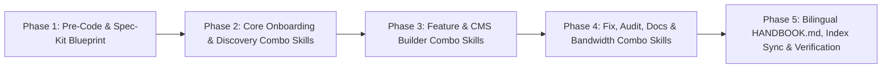

# 06 — Implementation Plan: Agent OS Beginner Handbook & 11 Situation Combo Skills

## 1. Execution Dependency Graph

---

## 2. Phase 1: Foundations, Pre-Coding Verification & Spec-Kit Artifacts
- [x] Author all 6 Pre-Coding Pillars in `docs/precode/handbook/` and achieve 100% clearance via `python scripts/agent_os.py precode audit docs/precode/handbook`.
- [ ] Create Spec-Kit specification artifacts in `specs/001-beginner-handbook/` (`spec.md`, `plan.md`, `checklist.md`, `tasks.md`).

---

## 3. Phase 2: Project & Smart Feature Orchestration Skills
- [ ] Create `skills/start-project/SKILL.md` (Situation 5: Brand New Project from Zero — runs `/grill-me` + `/muaz-skill` Smart Intake Q1–Q28, `/web-precode`, `/spec-kit`, and stack-agnostic build).
- [ ] Create `skills/smart-feature/SKILL.md` (Situation 6: Auto-picks targeted Frontend/Backend/DB skills from plain Arabic/English feature description + runs `/grill-me` + `/muaz-skill` intake).

---

## 4. Phase 3: Stack-Agnostic Frontend, Backend, Full-Stack & WordPress Combo Skills
- [ ] Create `skills/feature-fe/SKILL.md` (Situation 2: New Frontend / CMS UI feature — any stack, `/grill-me` + `/muaz-skill` intake, Sticky Nav, Sticky Sidebar, `flex-1 min-w-0` Tables, Forms, RTL/LTR, all-media responsiveness).
- [ ] Create `skills/feature-febe/SKILL.md` (Situation 3: New Frontend + Backend feature — adds RBAC, server-side pagination/search/sort, field validation, safe file uploads, and stack security guards).
- [ ] Create `skills/feature-full/SKILL.md` (Situation 4: New Frontend + Backend + Database feature — adds schema design, foreign keys, indexes, soft deletes, N+1 prevention, and transactions).
- [ ] Create `skills/feature-wp/SKILL.md` (Situation 7: WordPress / WooCommerce feature — runs `/grill-me` intake + `/wp-guard` + `/woo-guard` + `/muaz-skill` + `/rtl-logical-guard`).

---

## 5. Phase 4: Fix, Quality Gate, Documentation & Data-Saver Combo Skills
- [ ] Create `skills/fix-ui/SKILL.md` (Situation 1: Scans UI violations via `/ui-audit`, generates fix prompts automatically, applies `/muaz-skill` + `/rtl-logical-guard` + CMS Sticky Nav/Sidebar/Table/Form fixes, and verifies via `/ui-review-loop`).
- [ ] Create `skills/fix-backend/SKILL.md` (Situation 8: Diagnoses and fixes API, Auth/RBAC, validation, or slow database query bugs and adds regression tests via `/test-guard`).
- [ ] Create `skills/check-all/SKILL.md` (Situation 9: Pre-push security, clean-code, test, and anti-bloat review combining security guards + `/ponytail-review` + `/debate-review`).
- [ ] Create `skills/doc-project/SKILL.md` (Situation 10: Generates/updates `README.md`, `docs/ARCHITECTURE.md`, and `docs/API.md` via `/project-documentation` + `/docs-guard`).
- [ ] Create `skills/save-data/SKILL.md` (Situation 11: Activates low-bandwidth IDE profile via `/data-saver` + `/caveman lite` + offline package caching).

---

## 6. Phase 5: Bilingual `HANDBOOK.md`, Global Sync & Automated Verification
- [ ] Author `HANDBOOK.md` at repository root in Bilingual Simple English + Arabic with the "Without vs. With `.agents`" hook, "Live Dogfooding Proof", "1-2-3 Traffic Light Rule", "Top 4 Magic Commands", and all 11 Situation Copy-Paste Cards.
- [ ] Update `SKILLS_DIRECTORY.md` and `README.md` to link prominently to `HANDBOOK.md` and list the 11 new Situation Combo Skills.
- [ ] Run `python scripts/agent_os.py index-skills`, `python scripts/agent_os.py sync --apply`, `python scripts/agent_os.py audit`, and `python scripts/agent_os.py test` to verify 100% parity and test pass rate.
