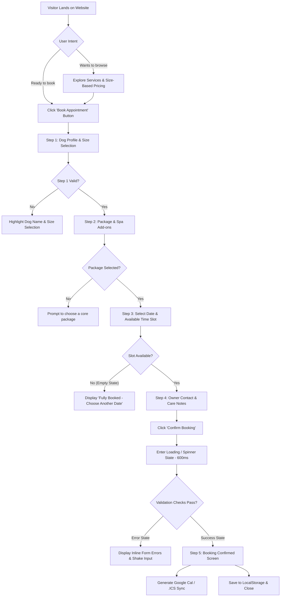
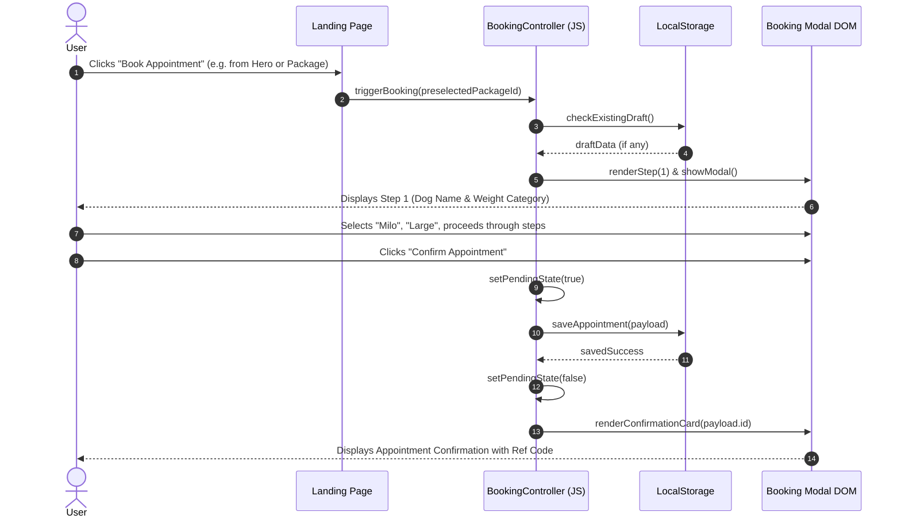

# App Flow & State Machine: Pawfect Grooming Salon & Spa

## 1. Route Map & Page Navigation Hierarchy

| Section Anchor / State | Access Level | Description | Interactive Triggers & Destinations |
| :--- | :--- | :--- | :--- |
| `/#hero` | Public | Hero value prop, trust statistics, primary CTA | Triggers `openBookingModal()` or scrolls to `/#services` |
| `/#services` | Public | Service cards with dynamic dog-size pricing switcher | Size buttons (`Small`, `Medium`, `Large`, `Giant`), "Select & Book" |
| `/#gallery` | Public | Before-and-after photo showcase with filter tabs | Filter tabs (`All`, `Doodles`, `Double Coat`, `Short Coat`) |
| `/#reviews` | Public | Verified pet parent testimonials & Google review score | Navigational dots and customer review quotes |
| `/#faq` | Public | Expandable accordion answering customer grooming questions | Accordion toggle buttons (`aria-expanded`) |
| `/#contact` | Public | Physical address, business hours, parking notes | Direct map link and phone click-to-call |
| `[Modal] Booking Wizard` | Interactive Overlay | 4-step appointment booking flow | Launches from any "Book Appointment" CTA button |

---

## 2. Primary User Journey Flowcharts

---

## 3. The 5-State UI Matrix
Every interactive component in Pawfect Grooming strictly implements the 5 UI states:

| Component / View | 1. Idle State | 2. Loading / Pending | 3. Success State | 4. Error State | 5. Empty State |
| :--- | :--- | :--- | :--- | :--- | :--- |
| **Size Pricing Switcher** | Size pills enabled with active pill highlighted | Smooth 150ms opacity transition on price change | New pricing and duration values displayed | Retains previous valid selection if click fails | N/A (Fixed 4 sizes) |
| **Time Slot Grid (Step 3)** | Time pills visible (9:00 AM, 11:30 AM, 2:00 PM, 4:30 PM) | Subtle skeleton shimmer while loading slots for selected day | Selected slot highlighted with primary amber ring | Red toast if slot was just claimed | "No appointments left on this date. Please pick another day." |
| **Booking Submission (Step 4)** | "Confirm Booking" button active with price total | Button disabled, text changes to "Securing Your Spot...", spinner rotates | Transitions to Step 5: green checkmark animation & Confirmation ID | Red border on invalid phone/email with inline alert | N/A (Form input) |
| **Saved Bookings Card** | Displays upcoming appointment details & countdown | Loading skeleton while reading storage | Renders appointment badge with "Upcoming Appointment" pill | Alerts user if local storage quota exceeded | "No upcoming appointments. Book your dog's first spa day above!" |

---

## 4. Session & Modal Interaction Sequence

---

## 5. Edge & Error Handling Protocol
- **Accidental Modal Closure (Draft Recovery)**: If a user closes the modal halfway through Step 3, their selections (`petName`, `dogSize`, `selectedPackage`) are stored in `sessionStorage`. Reopening the modal immediately restores their progress.
- **Past Date Selection**: The date picker input sets `min="YYYY-MM-DD"` to today's date, preventing selection of past dates.
- **Missing Required Fields**: If the user skips pet name or owner phone, the form automatically scrolls to the first invalid field and sets accessibility focus (`element.focus()`).
- **Offline Resilience**: The booking controller works 100% offline via local storage, ensuring zero downtime if the client's internet momentarily flickers.
