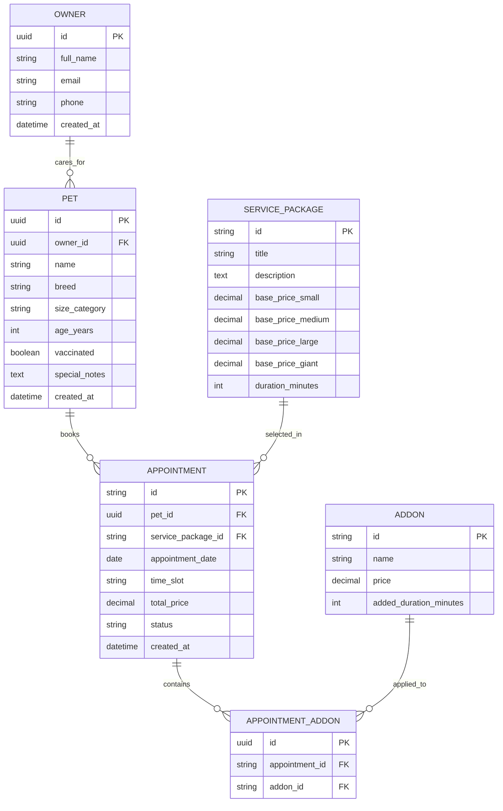

# Backend Schema & Data Model: Pawfect Grooming Salon & Spa

## 1. Storage Architecture & Strategy
- **Client-Side Model**: Structured JSON Schema stored under `localStorage.pawfect_appointments_v1` for instant standalone execution.
- **Production Server Model**: Relational PostgreSQL 16+ / Supabase DDL schema ready for drop-in backend integration (FastAPI, Next.js, or Laravel).
- **Data Integrity**: Enforced primary keys, foreign key references, size category enums, and appointment status constraints.

---

## 2. Entity Relationship Diagram (ERD)



---

## 3. Production Schema DDL / Table Definitions

```sql
-- 1. Owners Table
CREATE TABLE owners (
    id UUID PRIMARY KEY DEFAULT gen_random_uuid(),
    full_name VARCHAR(100) NOT NULL,
    email VARCHAR(255) NOT NULL,
    phone VARCHAR(30) NOT NULL,
    created_at TIMESTAMP WITH TIME ZONE DEFAULT CURRENT_TIMESTAMP
);

CREATE INDEX idx_owners_email ON owners(email);
CREATE INDEX idx_owners_phone ON owners(phone);

-- 2. Pets Table
CREATE TYPE dog_size_enum AS ENUM ('small', 'medium', 'large', 'giant');

CREATE TABLE pets (
    id UUID PRIMARY KEY DEFAULT gen_random_uuid(),
    owner_id UUID NOT NULL REFERENCES owners(id) ON DELETE CASCADE,
    name VARCHAR(80) NOT NULL,
    breed VARCHAR(100),
    size_category dog_size_enum NOT NULL DEFAULT 'medium',
    age_years INT DEFAULT 1,
    vaccinated BOOLEAN NOT NULL DEFAULT true,
    special_notes TEXT,
    created_at TIMESTAMP WITH TIME ZONE DEFAULT CURRENT_TIMESTAMP
);

CREATE INDEX idx_pets_owner_id ON pets(owner_id);

-- 3. Service Packages Table
CREATE TABLE service_packages (
    id VARCHAR(50) PRIMARY KEY,
    title VARCHAR(100) NOT NULL,
    description TEXT NOT NULL,
    base_price_small NUMERIC(6,2) NOT NULL,
    base_price_medium NUMERIC(6,2) NOT NULL,
    base_price_large NUMERIC(6,2) NOT NULL,
    base_price_giant NUMERIC(6,2) NOT NULL,
    duration_minutes INT NOT NULL DEFAULT 60
);

-- 4. Appointments Table
CREATE TYPE appointment_status_enum AS ENUM ('pending', 'confirmed', 'in_grooming', 'completed', 'cancelled');

CREATE TABLE appointments (
    id VARCHAR(20) PRIMARY KEY, -- e.g. PAW-8492
    pet_id UUID NOT NULL REFERENCES pets(id) ON DELETE CASCADE,
    service_package_id VARCHAR(50) NOT NULL REFERENCES service_packages(id),
    appointment_date DATE NOT NULL,
    time_slot VARCHAR(20) NOT NULL, -- e.g. '09:30 AM'
    total_price NUMERIC(6,2) NOT NULL,
    status appointment_status_enum NOT NULL DEFAULT 'confirmed',
    created_at TIMESTAMP WITH TIME ZONE DEFAULT CURRENT_TIMESTAMP,
    updated_at TIMESTAMP WITH TIME ZONE DEFAULT CURRENT_TIMESTAMP
);

CREATE INDEX idx_appointments_date_slot ON appointments(appointment_date, time_slot);
CREATE INDEX idx_appointments_pet_id ON appointments(pet_id);
```

---

## 4. Indexing Strategy & Query Optimization
- **Slot Conflict Lookup**: Compound index `idx_appointments_date_slot ON appointments(appointment_date, time_slot)` guarantees instant $\mathcal{O}(1)$ slot collision checks.
- **Foreign Key Index Invariant**: Every foreign key (`owner_id`, `pet_id`, `service_package_id`) has a dedicated B-tree index.
- **Client Storage Key Schema**:
  ```json
  {
    "id": "PAW-2941",
    "pet": {
      "name": "Milo",
      "breed": "Goldendoodle",
      "size": "large",
      "vaccinated": true,
      "notes": "Loves ear scratches, sensitive paws"
    },
    "service": {
      "packageId": "full_spa",
      "title": "The Full Spa Groom",
      "addons": ["blueberry_facial", "teeth_cleaning"]
    },
    "schedule": {
      "date": "2026-10-18",
      "timeSlot": "10:30 AM"
    },
    "owner": {
      "name": "Sarah Jenkins",
      "phone": "(555) 234-5678",
      "email": "sarah@example.com"
    },
    "totalPrice": 115,
    "status": "confirmed",
    "createdAt": "2026-10-10T09:00:00Z"
  }
  ```

---

## 5. Data Integrity & Lifecycle Policies
- **Cascading Deletions**: Deleting an owner cascades to delete their associated pets and appointment history (`ON DELETE CASCADE`).
- **Idempotent ID Generation**: Appointment codes are prefixed (`PAW-XXXX`) using cryptographic pseudo-random numbers to guarantee human-readable references.
